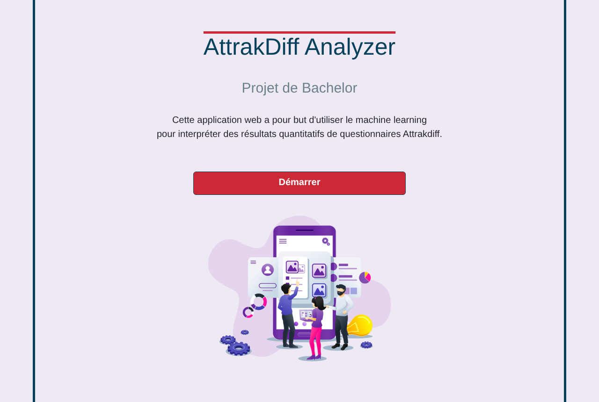
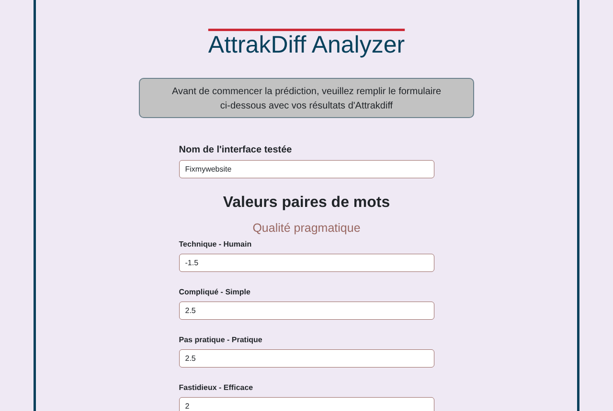
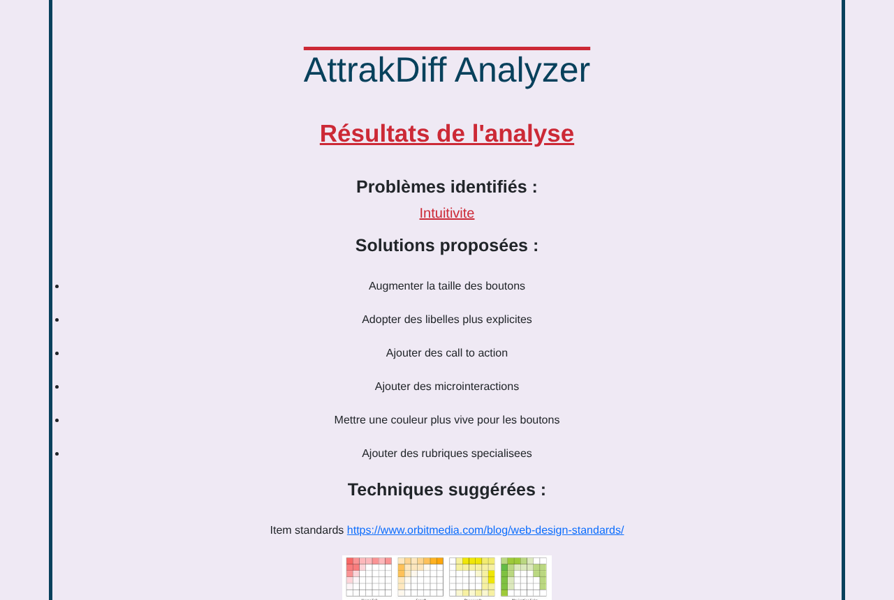

# AttrakDiff Analyzer : interpréter des questionnaires UX avec le machine learning

*Projet de Bachelor, Systèmes d'information et science des services, Université de Genève, 2024 · supervisé par le Pr Patrick Roth*

Le questionnaire **AttrakDiff** sert à évaluer l'expérience utilisateur d'une interface. Il produit des scores chiffrés sur 28 paires de mots (*compliqué/simple*, *laid/beau*…), que le designer doit ensuite traduire lui-même en problèmes concrets à corriger. Ce projet automatise cette étape d'interprétation. Un modèle de machine learning prédit, à partir des résultats AttrakDiff, les **points faibles de l'interface** (clarté, créativité, esthétisme, intuitivité, manque d'informations, professionnalisme). Une application web propose ensuite des **solutions de design** et des **techniques UX** adaptées à chaque problème.

| Accueil | Saisie des résultats | Résultats |
|---|---|---|
|  |  |  |

## Démarche

1. **Constitution du jeu de données** : des évaluations AttrakDiff tirées d'articles scientifiques et de projets d'étudiants, chacune étiquetée avec les problèmes d'interface identifiés.
2. **Comparaison de 24 configurations** de classification multi-label, évaluées par validation croisée *leave-one-out* :
   - 6 modèles : Naive Bayes, arbre de décision, Random Forest, KNN, régression logistique et SVM ;
   - 2 stratégies multi-label : *One-vs-Rest* et *Classifier Chains* ;
   - 2 niveaux de détail en entrée : les 28 paires de mots, ou les 4 moyennes par dimension.
3. **Modèle retenu** : Random Forest avec Classifier Chains sur les valeurs détaillées. Il obtient une précision par étiquette de 0,76 et une correspondance exacte de 0,36, des scores limités surtout par la petite taille du jeu de données.
4. **Application web Flask** : elle intègre le modèle entraîné et l'associe aux solutions et techniques correspondantes.

## Technologies

Python, scikit-learn, NumPy, Flask, HTML/CSS (Bootstrap)

## Structure

```
├── app/                    # Application web Flask (modèle entraîné, templates, solutions et techniques UX)
├── predictions/            # Code de prédiction utilisé par l'application
├── training/               # Les 24 configurations testées (LOOCV)
│   ├── OVR/                #   One-vs-Rest       → mean_values/ et detailed_values/
│   └── classifier_chains/  #   Classifier Chains → mean_values/ et detailed_values/
├── tests_moins_un/         # Tests en retirant un questionnaire du jeu d'entraînement
└── questionnaires/         # Jeu de données AttrakDiff (JSON) et questionnaires de test
```

## Lancer l'application

Le modèle a été enregistré avec **scikit-learn 1.4.1**. Il faut cette version pour le recharger, donc Python 3.9 à 3.12.

```bash
pip install scikit-learn==1.4.1.post1 "numpy<2" flask joblib

cd app
python app.py
```

Ouvrir ensuite http://127.0.0.1:5000, cliquer sur **Démarrer**, puis saisir le nom de l'interface et les valeurs moyennes des 28 paires de mots, entre -3 et 3. Des exemples de valeurs réelles se trouvent dans `questionnaires/questionnaires for prediction/`. L'application affiche les problèmes détectés, les solutions proposées et des techniques UX avec des liens et des illustrations.

> L'application doit être lancée depuis le dossier `app/` : les fichiers du modèle et des solutions y sont chargés avec des chemins relatifs.

## Reproduire l'entraînement

Chaque script de `training/` entraîne et évalue une configuration, puis affiche ses scores. Il faut le lancer depuis son propre dossier. Par exemple, pour le modèle retenu :

```bash
cd training/classifier_chains/detailed_values
python LOOCV_detailed_chains_FRST.py
```

## Rapport

Le mémoire complet (en français) détaille l'état de l'art, la constitution du jeu de données, la comparaison des modèles et l'évaluation de l'application.

📄 [Lire le rapport](rapport/Projet_de_Bachelor.pdf)
